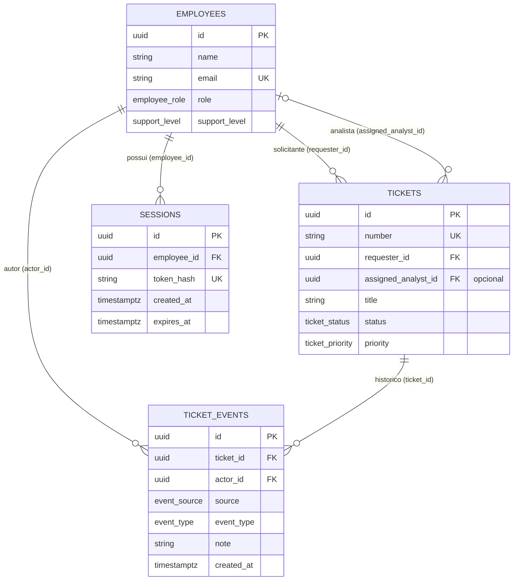

# Backend: parte 3 — autenticação de demonstração

Servidor HTTP do serviço simulado de chamados, separado da aplicação Next.js.
Implementa a estrutura HTTP, conexão PostgreSQL, login de demonstração e consulta
de chamados por funcionário autenticado. A interface Next.js ainda não está
conectada a essas rotas.

## Executar

Requer Node.js 24, npm e o PostgreSQL do projeto. Na raiz, execute
`sh scripts/db.sh up` para iniciar o banco e `sh scripts/db.sh migrate` para
aplicar as migrações, incluindo `002_sessions.sql`. Para cadastrar funcionários
de exemplo, execute `sh scripts/db.sh seed`. Veja o [guia do banco](../database/README.md).

Dentro de `backend/`:

```bash
npm ci
# Apenas se .env ainda não existir:
cp .env.example .env
npm run db:check
npm run dev
```

O servidor inicia em `http://127.0.0.1:3333`. Para conferir:

```bash
curl http://127.0.0.1:3333/health
```

Resposta:

```json
{ "status": "ok", "service": "nexo-assist-backend" }
```

Configure o `.env` desta pasta preservando qualquer arquivo existente. O `.env`
da raiz é usado pelo Docker Compose e não é carregado automaticamente pelo
servidor. A configuração da API precisa corresponder ao banco já inicializado:

| Variável no backend | Origem ou finalidade                                                           |
| ------------------- | ------------------------------------------------------------------------------ |
| `HOST`              | Endereço da API; padrão `127.0.0.1`                                            |
| `PORT`              | Porta da API; padrão `3333`                                                    |
| `NODE_ENV`          | `development`, `test` ou `production`; em produção o cookie exige HTTPS        |
| `APP_ORIGIN`        | Origem confiável da interface; padrão `http://localhost:3000`, sem barra final |
| `PGHOST`            | Endereço do PostgreSQL; padrão `127.0.0.1`                                     |
| `PGPORT`            | `POSTGRES_PORT` da raiz; padrão `5433`                                         |
| `PGDATABASE`        | `POSTGRES_DB` da raiz; padrão `nexo_assist`                                    |
| `PGUSER`            | `POSTGRES_USER` da raiz; padrão `nexo_local`                                   |
| `PGPASSWORD`        | `POSTGRES_PASSWORD` da raiz; obrigatório, sem valor padrão                     |

Os nomes `PGHOST`, `PGPORT` etc. seguem a convenção do driver PostgreSQL.
A senha do exemplo serve apenas para desenvolvimento local. Se a configuração
da raiz foi personalizada, ajuste os valores correspondentes no backend.
Não registre o objeto de configuração em logs, pois contém a senha.

## Entender o fluxo

```text
npm run dev
    → src/server.ts: lê a configuração, cria o pool e verifica o banco
    → SELECT 1: confirma que o PostgreSQL aceita uma consulta
    → abre a porta HTTP
    → src/app.ts: constrói a aplicação e registra as rotas
    → src/routes/health.ts: responde ao GET /health
```

- **Fastify:** framework que recebe requisições e executa a função da rota.
- **Zod:** verifica a configuração ao iniciar, incluindo portas e senha obrigatória.
- **pg:** driver que permite consultar o PostgreSQL pelo Node.js.
- **TypeScript:** verifica tipos com modo estrito e compila o código para JavaScript.
- **tsx:** executa TypeScript durante o desenvolvimento; o Node reinicia o
  processo ao detectar alterações. A verificação de tipos é um comando separado.
- **Prettier:** mantém a formatação consistente.

Separar `app.ts` de `server.ts` permite usar a aplicação em testes futuros sem
abrir uma porta. Os imports locais usam `.js` porque esse é o nome do arquivo
depois da compilação, conforme a resolução `NodeNext` do TypeScript.

O Node carrega o `.env` diretamente, sem necessidade de instalar `dotenv`.
SIGINT (Ctrl+C) e SIGTERM fecham o servidor, permitindo concluir requisições ativas.

## Como funciona o pool

Um pool mantém conexões disponíveis para reutilização. Cada processo da API cria
um pool ao iniciar, em vez de abrir uma nova conexão para cada requisição.

- `src/database/config.ts` converte as variáveis validadas para a configuração do driver.
- `src/database/pool.ts` cria o pool com no máximo cinco conexões, três segundos
  de espera para obter conexão, cinco segundos por comando SQL no servidor e
  seis segundos de limite no cliente. Conexões ociosas são fechadas após dez segundos.
- `src/server.ts` verifica a conexão com `SELECT 1` antes de abrir a porta HTTP.
  Se a consulta falhar, encerra os recursos e termina com código de erro.
- O hook `onClose` chama `pool.end()` ao encerrar a API. Falhas em conexões ociosas
  são tratadas e registradas sem imprimir a configuração.

Para uma consulta simples, usaremos `pool.query(...)`, que gerencia o empréstimo
e a devolução da conexão. Transações futuras usarão uma conexão reservada,
devolvida em `finally`, para manter todos os comandos na mesma transação.
Referência: [pooling no node-postgres](https://node-postgres.com/features/pooling).

`npm run db:check` cria um pool temporário, executa `SELECT 1` e fecha o pool,
mesmo em caso de falha. O comando não lê funcionários nem modifica dados.
Também não verifica se as migrações foram aplicadas.

Nesta etapa a conexão usa a conta administrativa local existente. Antes de
disponibilizar consultas de negócio, configuraremos os acessos apropriados.

## Relações entre as tabelas

O banco `nexo_assist` contém dois schemas: `app`, com os funcionários, e
`service_desk`, com os chamados e seu histórico. As chaves estrangeiras conectam
as tabelas mesmo estando em schemas diferentes.

O diagrama mostra os campos principais das tabelas já criadas pela migração:



`EMPLOYEES` representa `app.employees`; `TICKETS` e `TICKET_EVENTS` representam
`service_desk.tickets` e `service_desk.ticket_events`.
`SESSIONS` representa `app.sessions`: um funcionário pode ter várias sessões,
e cada sessão pertence a exatamente um funcionário.

- **Solicitante:** um funcionário pode abrir zero ou vários chamados. Cada
  chamado tem exatamente um solicitante, identificado por `requester_id`.
- **Analista responsável:** um analista pode atender zero ou vários chamados.
  Cada chamado pode ter zero ou um analista atribuído. O campo
  `assigned_analyst_id` fica nulo enquanto não houver atribuição, e o banco
  verifica que a pessoa atribuída possui perfil `analyst`.
- **Histórico:** cada evento pertence a exatamente um chamado, por `ticket_id`.
  A estrutura permite zero ou vários eventos por chamado; a futura API deverá
  garantir o evento de criação e registrar alterações na mesma transação.
- **Autor do evento:** cada evento referencia um funcionário por `actor_id`.
  Quando a operação vem do agente, esse funcionário é quem confirmou a ação;
  `source` identifica que a execução ocorreu pelo agente.

Na notação, `||` significa exatamente um, `o|` significa zero ou um e `o{`
significa zero ou vários. `PK` é a chave primária, `FK` é uma chave estrangeira
e `UK` indica um valor único.

Por exemplo, os chamados de Ana guardam o ID dela em `requester_id`. Ao atribuir
um deles a Rafael, o ID dele fica em `assigned_analyst_id`; o solicitante continua
sendo Ana. Cada atualização registrada gera um evento ligado ao chamado e à
pessoa responsável pela ação.

Essas relações já existem no PostgreSQL e a API já consegue conectar ao banco.
As consultas de negócio ainda serão implementadas.
Veja a [modelagem completa](../docs/03-modelagem-funcionarios-e-chamados.md)
para consultar todos os campos e regras propostas.

## Verificar e compilar

```bash
npm run typecheck
npm run format:check
npm test
npm run test:integration
npm run db:check
npm run build
npm start
```

O build gera `dist/`; `npm start` executa esse JavaScript. A pasta gerada não
é versionada. Ao instalar dependências, mantenha `package-lock.json` versionado
para permitir instalações reproduzíveis com `npm ci`.

## Consulta de chamados

O pool é criado uma vez em `server.ts`, passado para `buildApp({ pool })` e
entregue à rota por `app.register(ticketRoutes, { pool, getRequesterId })`.
Esse caminho é uma injeção de dependência: a rota recebe a conexão pronta,
sem criar outro pool e sem carregar credenciais por conta própria.

`GET /tickets` usa um parâmetro SQL para filtrar por `requester_id` e retorna
somente `result.rows`. A resposta contém os campos de consulta em `camelCase`
e a condição `overdue` calculada a partir do prazo. Falhas de consulta retornam
`503` com mensagem genérica, sem detalhes internos do banco.

`getRequesterId` consulta a sessão do cookie no banco e retorna o funcionário
ativo associado. Sem sessão válida, a rota responde com código `401`:

```json
{ "message": "Autenticação necessária." }
```

Nenhum chamado é consultado nesse caso. Parâmetros como `?requesterId=...` ou
headers com IDs livres não autenticam o funcionário. Até mesmo analistas recebem
somente seus próprios chamados nesta rota; o acesso pelo contexto do console
será implementado separadamente.

Os testes em `test/tickets.test.mjs` usam o test runner nativo do Node e simulam
o banco para verificar bloqueio sem identidade, filtro parametrizado pela
identidade do servidor, resposta sem metadados, lista vazia e indisponibilidade.
Não precisam de PostgreSQL em execução. Os testes em `test/auth.test.mjs` também
verificam validação, origem, rollback e liberação da conexão após falha no login.

## Autenticação e sessão

| Método e rota       | Resultado                                                                                       |
| ------------------- | ----------------------------------------------------------------------------------------------- |
| `POST /auth/login`  | Recebe `{ "email": "...", "password": "..." }`, retorna `{ "employee": ... }` e define o cookie |
| `GET /auth/me`      | Retorna o funcionário da sessão ou `401`                                                        |
| `POST /auth/logout` | Exclui a sessão, limpa o cookie e retorna `204`; também funciona sem sessão                     |
| `GET /tickets`      | Lista os chamados do funcionário da sessão ou retorna `401`                                     |

Conforme o PRD, este é um **login de demonstração**: qualquer senha não vazia é
aceita para um funcionário cadastrado e ativo. A senha é obrigatória, limitada
a 256 caracteres e não é persistida nem comparada com um segredo. O e-mail é
normalizado. E-mail desconhecido ou funcionário inativo recebe a mesma resposta
`401`; dados malformados recebem `400`. Isso não equivale a autenticação corporativa
de produção, mesmo com `NODE_ENV=production`.

`src/auth/sessions.ts` cria tokens aleatórios de 32 bytes. O navegador recebe
somente o token no cookie `nexo_session`, com `HttpOnly`, `SameSite=Lax` e duração
fixa de oito horas. Em produção, o cookie usa `Secure`. O PostgreSQL guarda apenas
o hash SHA-256 do token. Tokens não aparecem no JSON de resposta; cookies e
autorização são ocultados dos campos correspondentes nos logs do servidor.

Cada validação consulta a expiração no banco e o estado atual do funcionário.
Assim, desativar uma pessoa bloqueia suas sessões. O perfil também vem do banco.
Login gera novo token e, se o navegador já apresenta uma sessão, substitui essa
sessão na mesma transação. Sessões de outros dispositivos não são invalidadas.
Logout remove a sessão no servidor, então copiar o cookie antigo não mantém acesso.

As sessões sobrevivem ao reinício da aplicação porque estão no PostgreSQL.
Não há renovação automática nem limpeza agendada dos registros expirados nesta
etapa; eles permanecem inválidos. A opção visual “manter conectado” ainda não está
integrada e não altera o prazo fixo de oito horas.

Operações que alteram dados rejeitam `Origin` diferente de `APP_ORIGIN` e
requisições com `Sec-Fetch-Site: cross-site`. Clientes de terminal podem omitir
esses headers. Não liberamos CORS; a futura integração Next.js deverá encaminhar
cookies e requisições pelo servidor ou definir explicitamente essa integração.
Use consistentemente `127.0.0.1` ou `localhost`, pois cookies pertencem ao host.

Para testar no terminal, com a API iniciada, use um arquivo de cookies fora do Git:

```bash
curl -i -c /tmp/nexo-cookies.txt \
  -H 'Content-Type: application/json' \
  -d '{"email":"ana.souza@nexo.com.br","password":"qualquer"}' \
  http://127.0.0.1:3333/auth/login

curl -b /tmp/nexo-cookies.txt http://127.0.0.1:3333/auth/me
curl -b /tmp/nexo-cookies.txt http://127.0.0.1:3333/tickets

curl -i -X POST -b /tmp/nexo-cookies.txt -c /tmp/nexo-cookies.txt \
  http://127.0.0.1:3333/auth/logout
```

`npm run test:integration` requer o banco local e as migrações aplicadas. Ele
cria seus próprios funcionários e chamados temporários, valida login, hash,
cookies, isolamento, troca de sessão, expiração, desativação, logout e persistência
entre instâncias da aplicação, e remove seus registros ao final. Não utiliza
nem altera os funcionários de demonstração. Pode gerar lacunas na sequência de chamados.

## Próxima parte

Conectar o login e o chat Next.js à API, validar acesso às páginas no servidor
e implementar `GET /tickets/:id` com a mesma proteção por solicitante.

`/health` continua comprovando apenas que o servidor HTTP responde. Apesar da
verificação de conexão na inicialização, essa rota não consulta o banco a cada
requisição e não detecta uma queda posterior. As telas ainda usam dados em
memória e não estão conectadas a esta API.
