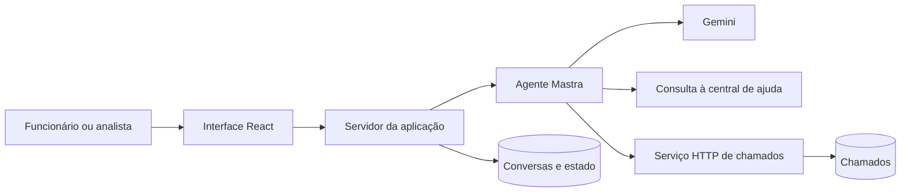

# Nexo Assist: proposta inicial

Status: proposta para discussão, antes da implementação.

## Tecnologias

- TypeScript com modo estrito, conforme o PRD.
- React com Next.js para as telas e os endpoints que atendem a interface.
- Zod para validar entradas e saídas estruturadas do modelo.
- Mastra para integrar o modelo e as ferramentas do agente.
- Gemini como provedor inicial, aproveitando a chave do Google AI Studio.
- PostgreSQL em Docker para persistência.
- Serviço HTTP de chamados separado da aplicação que executa o agente.

A versão do modelo e a biblioteca de acesso ao banco serão escolhidas na etapa
de configuração. A chave da API ficará no servidor, em variável de ambiente.

## Responsabilidades

O modelo interpreta a linguagem do funcionário e propõe ações. O código valida
essas ações e aplica as regras do service desk. Dados validados pelo Zod ainda
precisam passar por verificações de autorização e regras de negócio.

O servidor da aplicação identifica o usuário, salva as mensagens e verifica se
o agente pode responder. O serviço de chamados valida o acesso aos chamados e
executa as operações permitidas. O usuário autenticado vem da sessão; o modelo
não escolhe a identidade usada para acessar os dados.

Podemos usar uma instância de PostgreSQL local, com tabelas e responsabilidades
separadas. Conversas pertencem à aplicação; chamados pertencem ao serviço
simulado. O agente acessa chamados pela API desse serviço.

## Primeiro fluxo: abertura de chamado

1. O funcionário envia um relato, por exemplo: “Minha VPN não conecta”.
2. A aplicação salva a mensagem e verifica o estado da conversa e seu limite.
3. O agente consulta artigos e chamados do próprio funcionário para buscar
   uma solução e identificar possíveis duplicatas.
4. Se faltar informação relevante, pergunta ao funcionário. Neste exemplo,
   sistema operacional, erro exibido, pessoas afetadas e existência de alternativa
   podem mudar a orientação e a prioridade.
5. Se um artigo aplicável resolver a dúvida, responde com a orientação e a fonte.
6. Se for necessário alterar chamados, prepara um rascunho com a operação
   proposta, título, descrição, tipo, categoria, prioridade e quem é afetado.
7. O funcionário confirma o rascunho. Se pedir mudanças, recebe uma nova versão.
8. O servidor verifica que a confirmação corresponde ao rascunho atual e manda
   executar a operação no serviço de chamados.
9. A aplicação salva o resultado e mostra o chamado junto das ações realizadas.

Um chamado aberto para o mesmo problema deve ser atualizado. Um chamado
resolvido há até sete dias pode ser reaberto. As alterações exigem confirmação.
Uma repetição de requisição após falha de rede não pode criar outro chamado:
o serviço precisará reconhecer a mesma operação, usando uma chave de idempotência.

Transferência para analista pode interromper esse fluxo quando o funcionário
pedir, o caso for crítico, houver chamado vencido ou faltar segurança para agir.
Após a transferência, o agente fica pausado até ser liberado pelo analista.

## Transparência

Cada resposta do agente terá um registro legível com intenção identificada,
ferramentas utilizadas, resultado resumido, segurança declarada e justificativa
breve baseada nos dados e nas regras aplicadas. Essa segurança é um sinal para
orientar o fluxo, não uma garantia estatística de acerto.

O registro explica as decisões sem depender da exposição do raciocínio interno
do modelo e respeita a privacidade dos chamados.

## Pontos a definir nas próximas etapas

- Modelo Gemini, biblioteca de banco e versões das dependências.
- Como o protótipo do Anexo C orienta os componentes visuais.
- Fuso e calendário usados no cálculo de horas e dias úteis.
- O que conta como mensagem no limite de 30 e como uma nova sessão começa.
- Limiares de segurança e critérios para reconhecer chamados sobre o mesmo problema.
- Comportamento diante de indisponibilidade temporária do serviço de chamados.

## Sequência de implementação

1. Revisar esta proposta e compreender o fluxo de abertura.
2. Preparar TypeScript, Docker e banco, explicando cada arquivo.
3. Modelar funcionários e chamados; implementar e validar o serviço simulado.
4. Integrar o agente com ferramentas restritas e testar decisões importantes.
5. Construir o chat com confirmação, persistência e transparência.
6. Construir o console do analista e validar a transferência de atendimento.
7. Completar cenários do PRD, documentação e instruções de execução.
