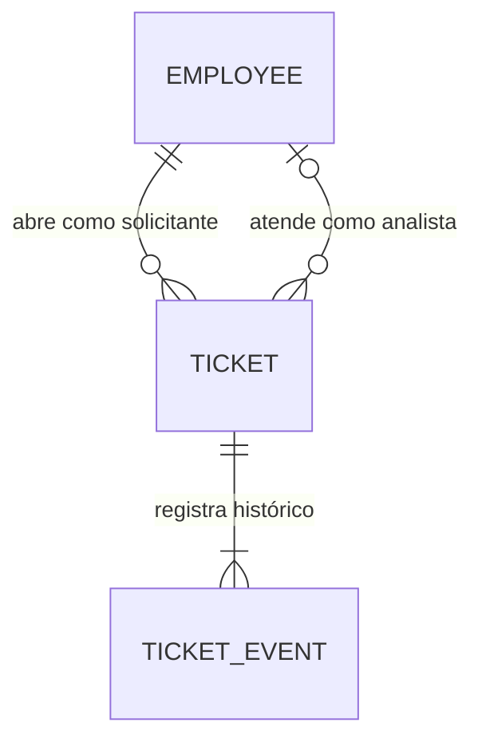

# Modelagem de funcionários e chamados

Esta é a proposta inicial do domínio, baseada nos Anexos A e B do PRD.
Ainda não cria tabelas nem altera os componentes das telas. Os nomes em inglês
serão usados no código; os rótulos em português aparecem na interface.

## 1. Funcionário: `app.employees`

Cada registro representa uma pessoa que pode entrar na aplicação. Analistas
também são funcionários; o perfil define as permissões de atendimento.

| Campo | Tipo proposto | Obrigatório | Finalidade |
| --- | --- | --- | --- |
| `id` | UUID | Sim | Identificador interno, estável |
| `name` | Texto, até 120 caracteres | Sim | Nome exibido nas telas |
| `email` | Texto, até 254 caracteres, único | Sim | Identificação no login corporativo |
| `role` | `employee` ou `analyst` | Sim | Permissões da pessoa |
| `department` | Texto, até 120 caracteres | Não | Contexto do atendimento |
| `supportLevel` | `n1` ou `n2` | Para analistas | Nível do suporte |
| `isActive` | Booleano, padrão `true` | Sim | Permite desativar o acesso sem apagar o histórico |
| `createdAt` | Data/hora com fuso | Sim | Criação do registro |
| `updatedAt` | Data/hora com fuso | Sim | Última alteração cadastral |

Antes de salvar ou pesquisar, o e-mail será normalizado removendo espaços nas
extremidades e convertendo para minúsculas. O banco garantirá a unicidade dessa
forma normalizada. O login aceitará somente pessoas cadastradas e ativas.

Não haverá campo de senha nesta versão: o PRD pede aceitar qualquer senha
para os funcionários dos dados de exemplo. A sessão autenticada será modelada
separadamente. Isso é uma autenticação de demonstração, que deverá constar no README.

Regra: `employee` tem `supportLevel = null`; `analyst` tem nível `n1` ou `n2`.
Os limites de texto e a representação dos perfis são escolhas desta proposta.

## 2. Chamado: `service_desk.tickets`

Um chamado representa um problema ou pedido de TI. A conversa é o canal pelo
qual o funcionário solicita e acompanha o atendimento; será outra entidade.

| Campo | Tipo proposto | Obrigatório | Finalidade |
| --- | --- | --- | --- |
| `id` | UUID | Sim | Identificador interno |
| `number` | Texto único | Sim | Código legível, como `INC-20311` |
| `requesterId` | UUID de funcionário | Sim | Pessoa que abriu; define o acesso do funcionário |
| `assignedAnalystId` | UUID de funcionário analista | Não | Responsável pelo chamado, quando atribuído |
| `supportLevel` | `n1` ou `n2`, padrão `n1` | Sim | Fila de suporte responsável |
| `title` | Texto, de 1 a 160 caracteres | Sim | Resumo do problema ou pedido |
| `description` | Texto, de 1 a 5000 caracteres | Sim | Contexto e informações coletadas |
| `type` | `incident` ou `request` | Sim | Incidente ou requisição |
| `category` | Categoria permitida abaixo | Sim | Classificação do assunto |
| `priority` | Prioridade permitida abaixo | Sim | Classificação de atendimento |
| `status` | Status permitido abaixo | Sim | Situação do chamado |
| `affectedScope` | `individual`, `team` ou `company` | Sim | Quem é afetado |
| `impactDescription` | Texto, até 2000 caracteres | Sim | Quem foi afetado e o que deixou de funcionar |
| `workBlocked` | Booleano | Sim | Indica impedimento de trabalho |
| `hasWorkaround` | Booleano | Sim | Indica existência de alternativa |
| `urgencyDescription` | Texto, até 2000 caracteres | Sim | Compromisso em risco ou ausência de urgência |
| `commitmentAt` | Data/hora com fuso | Não | Horário do compromisso, quando conhecido |
| `priorityReason` | Texto, até 2000 caracteres | Sim | Justificativa verificável da prioridade |
| `createdAt` | Data/hora com fuso | Sim | Abertura |
| `updatedAt` | Data/hora com fuso | Sim | Última alteração do registro |
| `lastServiceUpdateAt` | Data/hora com fuso | Não | Última resposta ou atualização do suporte |
| `nextResponseDueAt` | Data/hora com fuso | Sim | Prazo da primeira resposta ou próxima atualização |
| `resolvedAt` | Data/hora com fuso | Quando resolvido | Referência para a janela de reabertura |
| `version` | Inteiro positivo, padrão `1` | Sim | Identifica a versão e ajuda a evitar alterações concorrentes |

Textos obrigatórios não podem conter somente espaços. UUID é um identificador
interno; `number` é o código que o funcionário vê. O servidor gera ambos.
O número terá prefixo `INC` para incidente e `REQ` para requisição, usando uma
sequência no banco, sem calcular o próximo valor a partir da quantidade de linhas.
Após a criação, tipo e número permanecem estáveis nesta primeira versão.

### Valores permitidos

| Campo | Valor no código | Rótulo na tela |
| --- | --- | --- |
| `type` | `incident` | Incidente |
| `type` | `request` | Requisição |
| `category` | `access` | Acesso |
| `category` | `network_vpn` | Rede e VPN |
| `category` | `hardware` | Hardware |
| `category` | `software` | Software |
| `category` | `email` | E-mail |
| `category` | `other` | Outros |
| `priority` | `critical` | Crítica |
| `priority` | `high` | Alta |
| `priority` | `medium` | Média |
| `priority` | `low` | Baixa |
| `status` | `open` | Aberto |
| `status` | `waiting_analyst` | Aguardando analista |
| `status` | `in_progress` | Em atendimento |
| `status` | `approved` | Aprovado |
| `status` | `resolved` | Resolvido |

Tipos, categorias e prioridades vêm do PRD. O conjunto de status é uma proposta
que contempla os exemplos e os fluxos necessários. `approved` aplica-se apenas a
requisições e continua sendo um chamado aberto, pois a entrega pode estar pendente.

“Não sei” é aceito durante a coleta no chat, mas precisamos esclarecer o impacto
antes de confirmar um chamado. O prazo e a prioridade não serão escolhidos
livremente pelo navegador. O servidor os valida segundo as informações coletadas.

### Prioridade e prazo

| Prioridade | Regra do PRD | Prazo |
| --- | --- | --- |
| Crítica | Algo parado para uma equipe ou para a empresa | 1 hora |
| Alta | Impede uma pessoa de trabalhar ou há compromisso no mesmo dia | 4 horas úteis |
| Média | Atrapalha, mas há alternativa | 3 dias úteis |
| Baixa | Pedido ou melhoria sem urgência | 5 dias úteis |

Afetar uma equipe não basta para tornar o chamado crítico: é necessário haver
algo parado. Os campos de impacto e urgência permitem justificar a decisão.
Se não houver dados suficientes para aplicar as regras, o agente pergunta ou
encaminha para um analista, sem preencher dados desconhecidos como `false`.

`overdue` (vencido) será calculado: `status != resolved` e horário atual maior
que `nextResponseDueAt`. Não será um status salvo, pois um chamado em atendimento
também pode estar vencido. Em resolvidos, o prazo anterior permanece para auditoria.

`updatedAt` não será usado para calcular o SLA: uma mudança administrativa ou
complemento enviado pelo funcionário não deve esconder a falta de resposta do suporte.
Propomos que respostas de atendimento reiniciem o prazo; essa interpretação e as
regras para mudanças de prioridade serão detalhadas e testadas na implementação.

Guardaremos instantes em UTC, usando `timestamptz`, e exibiremos no fuso definido
pela aplicação. Antes de implementar o cálculo de horas e dias úteis, definiremos
fuso do service desk, calendário e tratamento de feriados. O artigo de exemplo
indica atendimento das 8h às 18h, de segunda a sexta, e plantão crítico 24 horas.

## 3. Relações e responsabilidade pelos dados

Um funcionário pode abrir muitos chamados; cada chamado tem exatamente um
solicitante. Um analista pode atender muitos chamados; um chamado pode ainda
não ter analista atribuído. Ser afetado por um incidente coletivo não concede
acesso ao chamado de outra pessoa.

Os funcionários pertencem à aplicação; os chamados pertencem ao serviço simulado.
Como começaremos com uma instância PostgreSQL e dois schemas, podemos usar chaves
estrangeiras entre eles para preservar a integridade das referências. É um
acoplamento local deliberado: bancos independentes exigiriam outro mecanismo
de sincronização das identidades.

O serviço não altera cadastros de funcionários. A validação de perfil e atividade
do analista precisa de uma consulta controlada de identidade. A aplicação Next.js
acessa chamados pela API, sem escrever diretamente nas tabelas do serviço.
Os funcionários referenciados não serão removidos fisicamente; serão desativados.

## 4. Histórico auxiliar: `service_desk.ticket_events`

Além do estado atual, precisamos registrar o que aconteceu, especialmente na
reabertura. Por isso propomos uma tabela auxiliar desde o início.

| Campo | Tipo | Finalidade |
| --- | --- | --- |
| `id` | UUID | Identificador do evento |
| `ticketId` | UUID de chamado | Chamado ao qual pertence |
| `actorId` | UUID de funcionário | Pessoa responsável ou que confirmou a operação |
| `source` | `employee`, `analyst` ou `agent` | Canal de execução |
| `eventType` | `created`, `updated`, `assigned`, `transferred`, `resolved`, `reopened` | Ação registrada |
| `note` | Texto | Complemento ou resumo legível |
| `changes` | JSON com estrutura validada | Campos alterados, com valores anteriores e novos |
| `createdAt` | Data/hora com fuso | Momento do evento |

O histórico é acrescentado, sem edição dos eventos existentes. Alteração do
chamado e evento correspondente serão salvos na mesma transação. Uma abertura
sempre gera um evento `created`. Justificativas detalhadas do agente serão
modeladas junto das conversas, sem expor seu raciocínio interno.

## 5. Regras de integridade e acesso

- Na API do funcionário, o solicitante vem da sessão validada. Consultas filtram
  por esse identificador, inclusive ao buscar por ID ou número de chamado.
- Analistas autorizados acessam dados necessários ao atendimento pelo console;
  o agente atuando para um funcionário mantém o acesso limitado ao solicitante.
- `requesterId` não muda em uma atualização. O agente não escolhe outra identidade.
- Um chamado `resolved` tem `resolvedAt` preenchido; os demais têm esse campo nulo.
- Reabertura é permitida até sete dias corridos depois de `resolvedAt`, inclusive
  no limite. Mantém número e solicitante, volta a `open`, limpa `resolvedAt` e
  inicia novo prazo. Os eventos preservam a resolução anterior.
- Chamados de outro solicitante não são candidatos à atualização ou reabertura.
- O mesmo problema em um chamado ainda aberto deve atualizar esse chamado,
  depois da confirmação. Uma restrição única de título não identifica duplicidade.
- Criar, complementar ou reabrir exige confirmação do rascunho atual, verificada
  pelo servidor. Rascunhos e confirmações terão modelo próprio posteriormente.
- Repetir uma requisição após falha de rede não pode repetir a operação. O contrato
  da API incluirá chave de idempotência e persistência do resultado da operação.
- `version` é incrementado a cada alteração. Uma atualização com versão antiga
  deve ser recusada e revista, para não sobrescrever mudanças recentes.

## 6. O que não pertence ao chamado

`agent`, `waiting`, `assigned` e `closed` nas telas atuais descrevem o controle
da conversa. Eles serão persistidos na entidade de conversa. Assumir uma conversa
não atribui automaticamente todos os chamados do funcionário; encerrar a conversa
também não resolve automaticamente um chamado.

Textos como “há 5 dias”, horário formatado, iniciais, cores do avatar e contadores
serão derivados dos dados para apresentação. Não serão campos de negócio.

Os tipos atuais das telas são dados de demonstração. Depois criaremos contratos
validados com Zod e adaptaremos os componentes, incluindo `critical`, tipo do
chamado e categorias do PRD. Não precisamos substituir todos os tipos visuais
pelas entidades completas do banco.

## Próxima etapa

A infraestrutura e a primeira migração SQL estão implementadas em `database/`.
Veja [o guia do banco](../database/README.md) para executar e entender o que já
é garantido pelo banco e o que ainda será responsabilidade da API. A biblioteca
de acesso ao banco será escolhida ao implementar o serviço de chamados.
